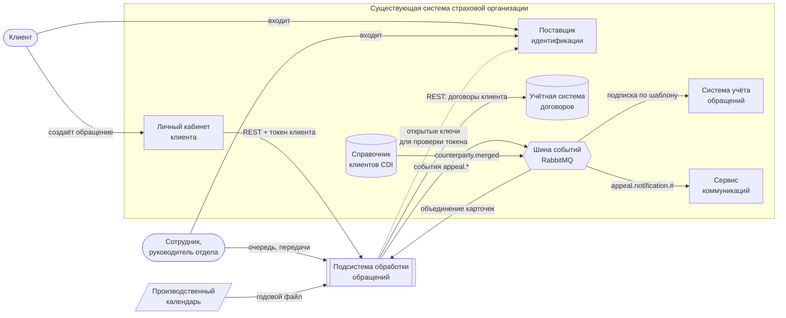

# Контракт интеграции подсистемы

С кем подсистема обработки обращений взаимодействует и на каких условиях. Форма
синхронных вызовов описана в [contracts-api.yaml](contracts-api.yaml); здесь — смысл
полей, требования к токену, каталог событий и гарантии. Решения, на которых держится
контракт, — в [decisions.md](decisions.md), номера указаны в скобках.

---

## Диаграмма контекста



Подсистема владеет только обработкой обращения: приёмом, привязкой к договору,
маршрутизацией, сроками, передачей между отделами и журналом. Всё остальное — внешние
системы (решения 15, 17). Рабочее место сотрудника входит в подсистему: очередь отдела,
сроки и передачи — её предметная область. Личный кабинет клиента — нет: это отдельный
продукт страховой, который вызывает API подсистемы.

В стенде внешние системы замещены эмуляторами (решение 19):

| Внешняя система | В стенде |
|---|---|
| Поставщик идентификации | Keycloak |
| Учётная система договоров | WireMock по `contracts-api.yaml` |
| Личный кабинет клиента | демонстрационный экран клиента |
| Система учёта обращений | очередь-подписчик на `appeal.#` |
| Сервис коммуникаций | очередь `communications.appeal-notifications`: запросы уведомлений видны в RabbitMQ и журнале событий, доставка не эмулируется |
| Производственный календарь | импорт файла в таблицу |
| Справочник клиентов (CDI) | событие объединения карточек публикуется вручную в обменник `cdi.events` |

---

## 1. Учётная система договоров

Синхронный REST, подсистема — клиент. Три вызова:

| Вызов | Когда | Сколько ждём |
|---|---|---|
| `GET /clients/{counterpartyId}/contracts` | клиент открывает раздел обращений | до 3 с, затем деградация |
| `GET /contracts/{contractId}` | регистрация обращения, фоновая до-привязка | фоновый путь — с повторами (решение 10) |
| `GET /contracts?policyNumber=` | оператор контакт-центра ищет клиента по номеру договора (решение 38) | до 3 с, как кабинет |

### Смысл полей договора

| Поле | Смысл |
|---|---|
| `counterpartyId` | страхователь, сторона договора; тот же идентификатор, что в токене клиента |
| `policyNumber` | номер полиса в том виде, в каком его видит клиент |
| `product.code` | продукт: `CASCO`, `OSAGO`, `MORTGAGE`, `PROPERTY`, `LIFE`. Разрез аналитики (решение 23) и выбор допустимых типов обращения (решение 24) |
| `validFrom`, `validTo` | период страхования, обе даты включительно |
| `terminatedOn` | дата досрочного прекращения: с этого дня договор не действует |
| `status` | состояние **на сегодня**, только для показа |
| `insuredSum`, `deductible`, `premium` | страховая сумма, франшиза, премия — для решения по существу |
| `paymentStatus` | оплата премии: `PAID`, `INSTALLMENTS`, `OVERDUE` |
| `coverages` | застрахованные риски: код и название |
| `parties` | участники договора с ролями: `POLICYHOLDER`, `INSURED`, `BENEFICIARY`. По ним подсистема определяет роль клиента (решение 43); если списка нет, участник один, страхователь |

Условия договора (сумма, франшиза, риски, оплата) подсистема в обращении **не хранит**:
сотрудник запрашивает их при рассмотрении, и они всегда актуальны. В снимке остаётся
только то, что фиксирует договор на момент обращения: номер, продукт, объект, период
и роль клиента в договоре.
Поля добавлены без изменения прежних — правило «изменения только добавляющие»
соблюдено.

**Покрытие на дату события.** Договор покрывает дату `D`, если
`validFrom ≤ D ≤ validTo` и при этом `terminatedOn` отсутствует или `D < terminatedOn`.
Проверка покрытия (решение 21) опирается на даты, а не на `status`: статус описывает
сегодняшний день, а страховой случай мог произойти раньше. Договор, сегодня имеющий
статус `EXPIRED`, вполне мог покрывать событие прошлого месяца.

**Обращение можно создать по договору в любом статусе.** Клиент вправе написать и по
истёкшему договору — например, о возврате переплаты.

### Ответы и ошибки

| Ответ | Как трактует подсистема | Повтор |
|---|---|---|
| `200` | данные договора | — |
| `404` | договора нет или он не принадлежит клиенту; регистрация с ним отклоняется | нет — результат не изменится |
| `5xx`, таймаут | сбой учётной системы | да, по политике пути; при неудаче — деградированный режим (решения 9–11) |

### Снимок в обращении

Учётная система — источник правды о договоре, но обращение хранит **снимок** его полей на
момент регистрации: номер полиса, продукт, объект, период, дату прекращения. Обращение
фиксирует, каким договор был, когда клиент писал, и не меняется задним числом (решение 19).

### Доступ

Подсистема обращается к учётной системе под сервисной учётной записью (OAuth2 client
credentials, право `contracts.read`). В стенде не проверяется.

---

## 2. Поставщик идентификации

Подсистема никого не аутентифицирует (решение 22). Она работает как OAuth2 Resource
Server: принимает токен из заголовка `Authorization: Bearer`, проверяет подпись по
открытым ключам IdP, издателя, аудиторию и срок.

### Требования к токену

| Поле | У кого | Смысл |
|---|---|---|
| `iss` | все | издатель — IdP страховой организации |
| `aud` | все | содержит `insurance-appeals` |
| `exp` | все | срок действия |
| `sub` | все | идентификатор пользователя в IdP |
| `roles` | все | `CLIENT`, `SPECIALIST`, `SUPERVISOR`, `ADMIN` |
| `counterparty_id` | клиенты | идентификатор контрагента в учётной системе |
| `department` | сотрудники | код подразделения, например `CLAIMS` |

**Идентификатор клиента берётся только из `counterparty_id`, никогда из запроса.**
Подставить чужой идентификатор в запрос нельзя — его там нет.

Поле называется `counterparty_id`, а не `client_id`: в OAuth `client_id` уже означает
приложение, получившее токен, и совпадение имён привело бы к путанице.

**Сопоставление идентификаторов — ответственность страховой.** Идентификатор
пользователя в IdP и идентификатор контрагента в учётной системе могут различаться;
как `counterparty_id` попадает в токен, решает страховая организация.

---

## 3. События подсистемы

Подсистема публикует факты о жизни обращения в обменник `appeal.events` (тип topic,
устойчивый). О потребителях она не знает: каждый объявляет свою очередь и привязывает её
к обменнику своим шаблоном (решение 1).

### Конверт

| Поле | Смысл |
|---|---|
| `eventId` | уникальный идентификатор события — ключ дедупликации для потребителя |
| `eventType` | тип события, например `APPEAL_ROUTED` |
| `appealId` | идентификатор обращения |
| `routingKey` | ключ маршрутизации, с которым событие опубликовано |
| `details` | атрибуты события, строковые пары ключ — значение |
| `occurredAt` | момент события, UTC |

### Каталог

| `eventType` | Ключ маршрутизации | Когда | `details` |
|---|---|---|---|
| `APPEAL_CREATED` | `appeal.created.<категория>.<тип>` | обращение зарегистрировано | `category`, `subcategory`, `publicNumber` |
| `APPEAL_ROUTED` | `appeal.routed.<отдел>` | назначен отдел и срок — автоматически или руководителем | `departmentCode`, `subcategory`, `priority`, `slaHours`; `manual` — при ручной классификации |
| `APPEAL_ASSIGNED` | `appeal.assigned.<отдел>` | руководитель назначил исполнителя (решение 32) | `assignee` — идентификатор сотрудника в IdP |
| `APPEAL_CLASSIFICATION_REQUIRED` | `appeal.classification.required` | нет правила маршрутизации — отдел выберет руководитель (решение 31) | `category`, `subcategory` |
| `APPEAL_STATUS_CHANGED` | `appeal.status.<статус>` | сменился статус | `fromStatus`, `toStatus` |
| `APPEAL_MESSAGE_ADDED` | `appeal.message.<автор>` | новое сообщение в переписке | `authorType`, `attachments` (число файлов) |
| `APPEAL_ATTACHMENTS_ADDED` | `appeal.attachment.added` | приложены файлы | `count`; `messageId` — если файлы пришли с сообщением |
| `APPEAL_DEADLINE_EXTENDED` | `appeal.deadline.extended` | руководитель продлил срок по закону | `days`, `legalDeadline` |
| `APPEAL_CONTRACT_LINKED` | `appeal.contract.linked` | договор привязан после регистрации (решение 29) | `productCode`, `policyNumber` |
| `APPEAL_CONTRACT_CHOICE_REQUIRED` | `appeal.contract.choice_required` | подходит несколько договоров или ни одного — клиенту нужно выбрать | `reason`: `NEEDS_CHOICE` или `NOT_FOUND` |
| `APPEAL_TRANSFER_REQUESTED` | `appeal.transfer.requested.<целевой отдел>` | запрошена передача | `fromDepartment`, `toDepartment`, `requestedBy` — идентификатор сотрудника в IdP |
| `APPEAL_TRANSFER_APPROVED` | `appeal.transfer.approved.<целевой отдел>` | передача согласована | `fromDepartment`, `toDepartment`, `reviewedBy` — идентификатор сотрудника в IdP |
| `APPEAL_TRANSFER_REJECTED` | `appeal.transfer.rejected.<целевой отдел>` | передача отклонена | `fromDepartment`, `toDepartment`, `reviewedBy` — идентификатор сотрудника в IdP |
| `APPEAL_SLA_BREACHING` | `appeal.sla.breaching.<отдел>` | до срока по закону 2 рабочих дня или меньше (решение 14) | `departmentCode`, `legalDeadline`, `priority` |
| `APPEAL_SLA_BREACHED` | `appeal.sla.breached.<отдел>` | срок по закону истёк без ответа по существу | `departmentCode`, `legalDeadline`, `priority` |
| `CLIENT_NOTIFICATION_REQUESTED` | `appeal.notification.<шаблон>` | клиенту нужно сообщить о его обращении (решение 37) | `template`, `counterpartyId`, `appealNumber`, `registeredAt`, `legalDeadline`; у `ANSWER_READY` ещё `outcome` |

Сегменты ключа — в нижнем регистре. Примеры подписок:

| Потребитель | Шаблоны |
|---|---|
| Система учёта обращений | `appeal.routed.#`, `appeal.status.#`, `appeal.transfer.approved.#` |
| Сервис коммуникаций | `appeal.notification.#` |
| Руководитель отдела убытков | `appeal.sla.breaching.claims`, `appeal.transfer.requested.claims` |

### Уведомления клиенту

Когда сообщить клиенту, решает подсистема; как доставить, решает сервис коммуникаций
(решение 37). Шаблоны: `APPEAL_REGISTERED` (зарегистрировано, срок ответа),
`NEW_MESSAGE` (сотрудник написал), `DEADLINE_EXTENDED` (новый срок), `ANSWER_READY`
(ответ готов, итог). Требования к сервису коммуникаций:

- контакты клиента брать из CDI по `counterpartyId`, в событии их нет;
- канал выбирать по согласиям клиента; текст ответа по существу не пересказывать, а
  давать ссылку на личный кабинет;
- дедуплицировать по `eventId`: доставка at-least-once.

### Гарантии

- **Доставка at-least-once.** Событие может прийти повторно; потребитель обязан
  дедуплицировать по `eventId` (решения 3, 4).
- **Порядок не гарантирован.** Актуальное состояние обращения потребитель берёт из API
  подсистемы по `appealId`, а не восстанавливает по последовательности событий.
- **В событиях нет персональных данных клиента** — только идентификаторы и коды.
  Подробности потребитель запрашивает у API с собственными правами доступа.
- **Изменения только добавляющие:** новые поля в `details`, новые типы событий. Удаление
  поля или смена его смысла — это новый `eventType`, старый публикуется до отказа
  потребителей от него.

---

## 4. Производственный календарь

Не живая система, а справочные данные (решение 13). Раз в год загружается файл
утверждённого производственного календаря:

```
date,kind
2027-01-01,HOLIDAY
2027-01-09,WEEKEND
2027-02-22,WORKDAY
```

`kind`: `WORKDAY` — рабочий, `WEEKEND` — выходной, `HOLIDAY` — праздничный. Дни, не
перечисленные в файле, считаются по обычной неделе: понедельник — пятница рабочие.

Выходной и праздник различаются не для красоты: срок по ОСАГО считается в календарных
днях без нерабочих праздничных — выходные в него входят, праздники нет.

Файлы называются `production-calendar-<год>.csv` и кладутся в каталог календаря
(в стенде — `calendar/`). Подсистема загружает их при старте; повторная загрузка того же
года заменяет значения.

---

## 5. Личный кабинет клиента

Вызывает API подсистемы с токеном клиента. Форму обращения строит по схеме, которую
отдаёт подсистема: допустимые для продукта договора типы и обязательные поля
(решение 24). В стенде роль кабинета играет демонстрационный экран клиента.

`GET /api/form-schema?productCode={код продукта}&clientRole={роль}` — категории, типы
обращений и поля каждого типа. `clientRole` необязателен: если клиент в выбранном договоре
не страхователь, в схеме нет типов, которые оформляет только страхователь (решение 43).

| Поле | Смысл |
|---|---|
| `inputType` | `TEXT`, `DATE` (ГГГГ-ММ-ДД) или `NUMBER`; сервер проверяет формат |
| `required` | без значения обращение не регистрируется |
| `contractAttribute` | значение подставляет подсистема из договора; кабинет поле не показывает, присланное значение игнорируется |
| `hint` | подсказка для клиента |
| `documents` (у типа) | какие документы подсказать приложить; подсказка, а не обязательный набор (решение 42) |
| `policyholderOnly` (у типа) | обращение оформляет только страхователь |

Как показать поля — порядок уже задан схемой, вид элементов и раскладку — решает
кабинет.

---

## 6. Справочник клиентов (CDI)

CDI ведёт карточки клиентов. Если у одного человека оказалось две карточки (договор
оформлен в офисе, а в кабинете он зарегистрировался заново), CDI объединяет их и публикует
событие. Подсистема переносит обращения дубля на основную карточку (решение 44).

| Обменник | Ключ | Очередь подсистемы |
|---|---|---|
| `cdi.events` (topic, принадлежит CDI) | `counterparty.merged` | `appeal.counterparty-merges`, отказы в `appeal.events.dead` |

Тело события, только идентификаторы:

```json
{"duplicateId": "…", "masterId": "…", "mergedAt": "2026-10-25T09:00:00Z"}
```

Повтор события безопасен: у дубля обращений уже нет. Событие без двух разных
идентификаторов после трёх попыток уходит в очередь отказов. Учётную запись клиента
в поставщике идентификации на основную карточку перепривязывает CDI, не подсистема.

---

## Отклонения текущей реализации от контракта

Отклонений нет. Последние два устранены 18.10.2026:

- в событиях передачи вместо ФИО сотрудника — его идентификатор в IdP: персональные данные
  сотрудников наружу не уходят;
- справочник сотрудников удалён: кто действовал, подсистема берёт из токена и хранит в передаче
  идентификатор и имя на момент действия — так же, как имя клиента в обращении.
